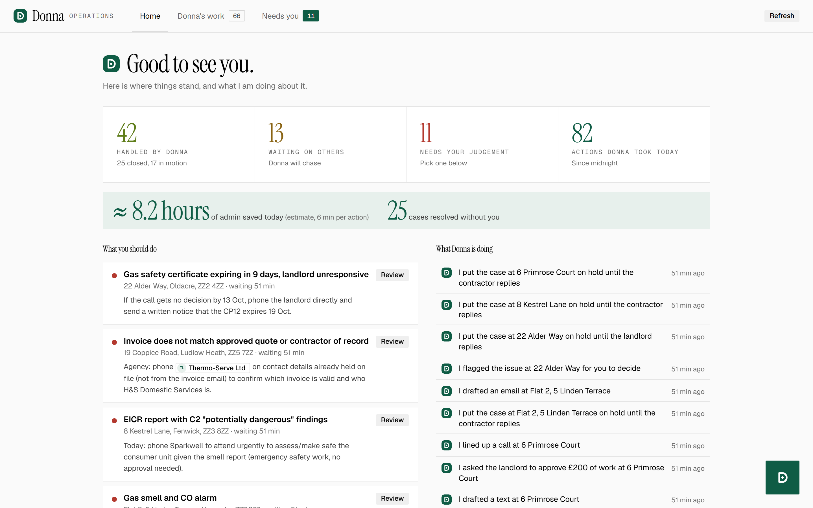
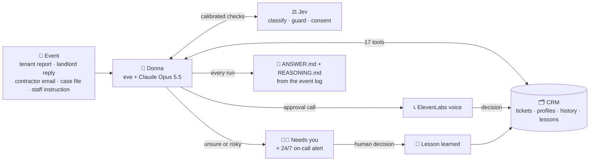
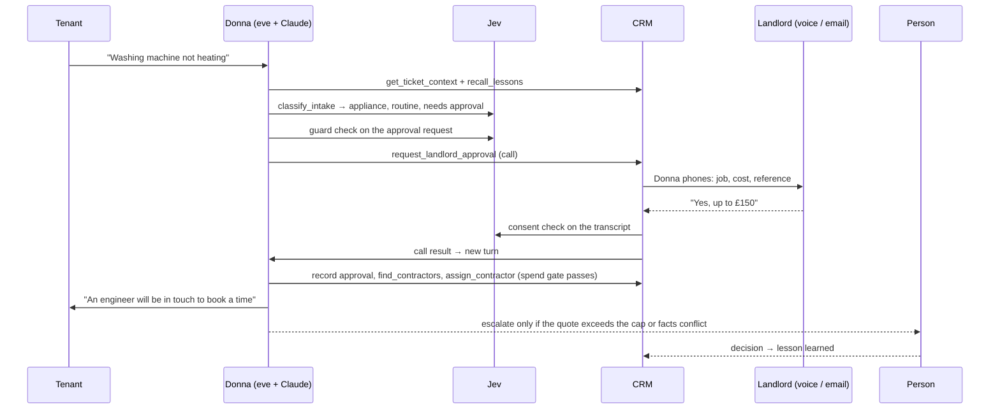
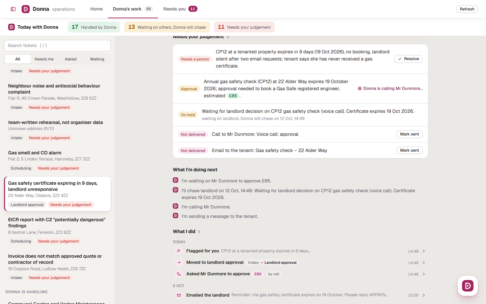
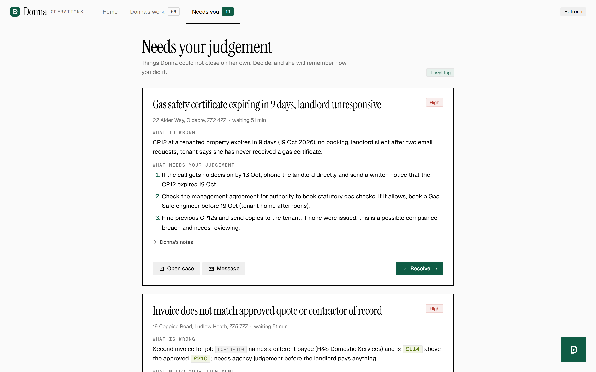
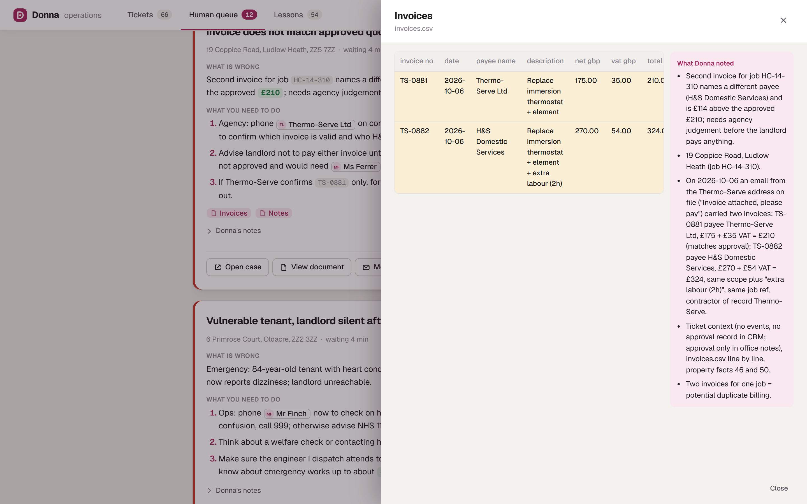
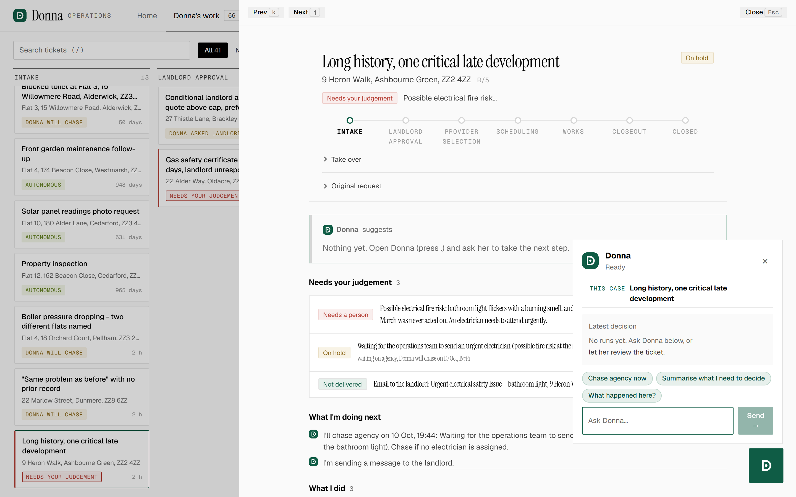

# Donna: the AI-native operations agent for lettings

Built for the Dwelly London AI Hackathon 2026, **Property Management** track.

Donna runs residential maintenance and compliance work end to end. She reads everything known about the property and the people, decides the next step, acts through an AI-native CRM, and pulls in a person only when a decision genuinely needs one. Staff see what Donna handled, what she is doing next, and the few cases that need their judgement.

| | |
|---|---|
| **Agent** | [eve](https://eve.dev) + Claude Opus 5.5 (direct Anthropic API), 17 tools, self-hostable |
| **Memory** | SQLite CRM: tickets, people and property profiles with sourced facts, holds, approvals, outbox, human queue, lessons |
| **Calibrated judgement** | Jev (TypeSafe AI) at intake, on every inbound reply, on every outbound action, and on call consent |
| **Hard safety rails** | Spend gate in code, outbound guard, consent check, credential refusal |
| **Voice** | ElevenLabs Agents: Donna phones landlords for approvals (browser or Twilio) |
| **Learns from the team** | Every human decision becomes a reusable lesson |
| **Results** | All 76 handoff points in the 50 public cases: **0 fail, 0 critical** (57 pass). 16 unseen hard cases: **14 pass, 0 fail**. See [docs/accuracy-report.md](docs/accuracy-report.md) |



---

## 1. What we built

### Donna, the agent
- **Acts, doesn't chat.** Triggered by events (a tenant report, a landlord reply, a contractor email, a follow-up date, an instruction from staff). Her output is real changes in the CRM and an auditable record of why.
- **17 tools** on the CRM: read the ticket and every profile, search the history, read attachments (PDF invoices, reports, photos via Claude), classify requests and replies (Jev), recall team lessons, find and assign contractors, move the stage, place and release holds with follow-up dates, request landlord approval by email or **phone call**, record the landlord's answer, message tenants, landlords and contractors, find existing cases, and escalate with a structured handover.
- **Does the work herself.** Routine approvals, chasing, calls and messages happen without a person. Staff can also just ask: "call the landlord for approval", "chase the contractor".
- **Knows when to stop.** Conflicts, disputed invoices, safety risks, vulnerability, legal or financial matters, and anything she can't resolve by asking go to the human queue with what happened, what she checked, what is uncertain, and a recommendation.
- **Beyond the dataset.** Any input format (case folders, single `.txt`/`.json`/`.md` files, notes plus CSV), any language, out-of-scope cases (arrears, deposits, neighbour disputes, insurance) handed over properly, compliance work (gas safety CP12, EICR, EPC, alarms, licences), and "do nothing" as a real decision.

### The AI-native CRM (operations console)
- **Home:** what Donna handled, what she is waiting on (and when she will chase), what needs you, actions taken today, and an estimate of admin time saved. A live feed shows what Donna is doing, in her own words.
- **Needs you:** each item Donna couldn't close is a decision card: what is wrong, what you need to do, one-click actions. Invoice numbers, people and amounts become clickable chips; documents open in a drawer beside Donna's notes.
- **Tickets read as Donna's story:** an autonomy badge, "What I'm doing next", and a compact typed timeline of "What I did". Manual controls sit behind "Take over".
- **Floating Donna assistant:** ask her anything about the case and she carries it out.
- **Learning moment:** when a person resolves, accepts, edits or rejects something, a "New lesson" card flies into Donna's memory and a toast says what she learned.

### Learning from the team
Every human action in the console (resolve an escalation, assign a contractor, send a message, accept, edit or reject Donna's suggestion) is logged and turned by Claude into a generalised lesson: situation → action → why. Donna recalls the relevant lessons before deciding and cites the one she followed. 54 lessons were mined from the human operators in the public dataset to start with. Votes and usage decide which lessons she recalls first.

### Always on
- **Holds are chased automatically** when their follow-up date passes (console worker, or `node scripts/chase-holds.ts` from cron).
- **24/7 on-call alerts:** every escalation emails the on-call person; high-priority ones also phone them (Twilio, read out in a British voice). Alerts are logged on the ticket.
- **Approvals by phone:** when Donna requests approval by call, the call starts by itself; the landlord's answer is extracted, consent-checked by Jev, and recorded.

### Reality Test runner
Unseen cases are normalised, imported into the CRM and processed unattended. `ANSWER.md` and `REASONING.md` are rendered only from the recorded eve event stream plus the CRM before/after diff: decision, case type, why this decision, alternatives rejected, checks performed, assumptions, actions (including failed ones), approvals, escalation and handover, what couldn't be verified, and run metadata. Each case has a 6-minute timeout and failed cases are retried automatically.

## 2. The operational problem

We analysed the 50 public Property Management cases. They look like exports from Dwelly's own maintenance system and show where operations stall:

- **Every inbound reply stops automation.** "Please check if we need to provide a response… If not, please return this request to auto mode" appears 53 times in 50 cases.
- **Cases sit on hold:** 236 holds, 4.7 per case, mostly waiting for a provider or landlord.
- **Contractor emails fail extraction** ("expected data could not be extracted, please review manually"), and invoices name the same provider three different ways.
- **Long cycle times:** from under a day to 136 days.
- **A third need no contractor:** 17 of 50 closed "without payment" because the tenant or landlord fixed it.

Donna takes those handoff decisions herself and escalates only what genuinely needs a person.

## 3. Architecture



1. **An event arrives** and is imported into the CRM if it's new.
2. **Donna loads context:** the ticket, the property's history, every person's profile, and relevant team lessons.
3. **Jev scores it:** category, urgency, scope, and whether a reply can be handled automatically.
4. **Donna acts through tools.** Every outbound message and approval record passes Jev's guard; every spend passes the spend gate.
5. **When it isn't her call**, she escalates with a handover and the on-call person is alerted.
6. **People decide, Donna learns**, and every run is recorded.

**One request, end to end**



### Safety rails in code (not just in the prompt)

| Rail | What it enforces |
|---|---|
| **Spend gate** (`crm/gates.ts`) | Assigning a contractor or moving to scheduling, works or close-out needs an approved landlord approval, a recorded standing authority, admin/compliance work, or an emergency **already escalated to a human at high priority**. An "emergency" label alone unlocks nothing; it is only stored when Jev is confident. Exploit tests in `crm/gates.test.ts`. |
| **Outbound guard** (Jev) | Blocks messages that claim work is done, booked, paid or approved without evidence, promise unconfirmed dates, contain credentials or bank details, or commit the landlord's money. Statements of intent and safety advice pass. Donna rewrites and retries. |
| **Approval integrity** | Conditional or ambiguous answers can't be recorded as approval; phone and browser calls both require no conditions, a cap that covers the amount, and a Jev consent check. |
| **Credentials** | Passwords, alarm and key-safe codes and bank details are refused by the profile tool. |
| **Injection resistance** | Case content is passed as data inside `<case_file>`; embedded instructions are treated as information. |

### See it

**Home.** What Donna handled, what she is waiting on, what needs you, and her live activity feed.


**A ticket, told by Donna.** Autonomy badge, what she's doing next, and a compact typed timeline of what she did: flagged for you, stage moves, approvals asked by phone with the amount, emails with one-line previews.



**Needs you: decisions, not paperwork.** What is wrong, what you need to do, and one-click actions. References, people and amounts are chips.



**Documents in context.** An invoice reference opens the actual file next to Donna's notes.



**Donna's work as a board.** Cases flow across stages; open any case in a drawer, with the Donna assistant following the case you are on.



### Repository layout

| Folder | What it is |
|---|---|
| `agent/` | The eve agent: `agent.ts` (Claude via the Anthropic API), `instructions.md` (judgement rules), `tools/` (17 tools), `channels/eve.ts` (HTTP Basic auth) |
| `crm/` | SQLite schema (`node:sqlite`), repository, case importer, spend gates, lessons, attachment reader |
| `intake/` | Jev layers: intake classifier, reply classifier and autonomy thresholds, outbound guard, consent check, profile rules, evals |
| `runner/` | Reality Test runner: case normalisation, contact recovery, CRM import, eve client, ANSWER/REASONING renderer |
| `console/` | The AI-native CRM: home, tickets, needs-you queue, document drawer, Ask Donna, learning, voice calls, outbox worker, hold chaser, on-call alerts |
| `practice/` | Evaluation at Dwelly's real handoff points and on hard cases, with Claude judges |
| `scripts/` | ElevenLabs and Twilio setup, lesson mining, hold chasing |
| `docs/` | Accuracy report, eval reports, Jev layers, learning, operations, eve notes |
| `data/` | Practice and hard-case runs with full traces, lessons, intake labels |

## 4. How to run

**Prerequisites:** Node 24, npm. Copy `.env.example` to `.env` and fill in the keys you have (section 5).

```bash
npm ci
npm run crm:import            # load the 50 public Property Management cases into the CRM
npx eve dev --no-ui           # Donna's API on http://127.0.0.1:2000
npm test                      # 40 unit tests (CRM, spend gates, lessons, Jev parsing and guards, renderer)
```

**Operations console:**

```bash
cd console && npm ci && npm run dev    # http://localhost:5181 (API on :5180)
```

Keyboard: `/` search, `j`/`k` move, `[` toggle the sidebar, `.` open Donna. For demos, `Shift+I` logs an inbound message.

**Reality Test (unattended):**

```bash
DONNA_LESSONS=0 npm run reality -- "<folder with the test cases>"
# writes ANSWERS/<n>/ANSWER.md, REASONING.md, events.ndjson, run.json and ANSWERS/INDEX.md
```

**Evaluations:**

```bash
npm run intake:eval                     # Jev intake accuracy on all 50 cases
node intake/guard-eval.ts               # outbound guard and reply classifier
node intake/scope-eval.ts               # off-topic, non-English and compliance routing
node practice/run.ts --limit 20         # Donna at Dwelly's handoff points (start eve with CRM_DB=data/practice/practice.db)
node practice/judge.ts && node practice/report.ts
node runner/reality.ts --cases data/hardcases --out data/hardcases-answers
node practice/hard-judge.ts && node practice/hard-report.ts
```

**Voice and phone setup:** `node scripts/setup-elevenlabs.ts` (voice agent) and `node scripts/setup-phone.ts` (Twilio number via ElevenLabs).

**Self-hosting on a VPS:**

```bash
npx eve build
PORT=3000 npx eve start --host 0.0.0.0
```

Put a TLS reverse proxy (Caddy or nginx) in front and forward **both** `/eve/` and `/.well-known/workflow/`. Persist `.eve/.workflow-data` and `data/crm.db`, set `DONNA_API_PASSWORD`, run under pm2 or systemd, and add `node scripts/chase-holds.ts` to cron.

## 5. Models, APIs and services

| Service | Used for | Env |
|---|---|---|
| Anthropic Claude Opus 5.5 (direct API) | Donna's reasoning and tool use | `ANTHROPIC_API_KEY`, `DONNA_MODEL` |
| Anthropic Claude Sonnet 5.5 | Attachment transcription; lesson generation; eval judges | same key |
| Jev by TypeSafe AI (`jev-latest`) | Intake, reply, guard, consent and scope classification | `TYPESAFE_API_KEY` |
| ElevenLabs Agents | Landlord approval calls (browser and phone) | `ELEVENLABS_API_KEY`, `ELEVENLABS_AGENT_ID`, `ELEVENLABS_PHONE_NUMBER_ID` |
| Twilio | Phone line for approval calls and on-call alerts | `TWILIO_ACCOUNT_SID`, `TWILIO_AUTH_TOKEN`, `TWILIO_PHONE_NUMBER`, `DEMO_PHONE_TO`, `ONCALL_PHONE` |
| Resend | Outbound email and on-call alerts | `RESEND_API_KEY`, `DEMO_EMAIL_TO`, `ONCALL_EMAIL` |
| eve (Vercel, open source) | Agent framework: tools, durable sessions, event stream, traces | `DONNA_API_USER`, `DONNA_API_PASSWORD`, `EVE_URL` |
| Node `node:sqlite` | CRM storage | `CRM_DB` |

Feature flags: `DONNA_LESSONS` (lesson recall), `PHONE_AUTO_CALL`, `HOLD_CHASER`, `ONCALL_ALERTS`, `OUTBOX_WORKER`.

## Measured results

Full report: [docs/accuracy-report.md](docs/accuracy-report.md). Every number comes from runs of the submitted code; answers, traces and verdicts are in `data/`.

| Evaluation | Result |
|---|---|
| **All 76 of Dwelly's handoff points across all 50 public cases**, judged by Claude against what the human operator actually did next | **57 pass, 19 partial, 0 fail, 0 critical failures**; required outcome met 65/76; mean correct outcome 3.95/5, judgement & safety 4.03/5 |
| Held-out checks on decision points never used for tuning | 13/20 → 12/16 pass after fixes, both 0 fail |
| **16 unseen hard cases** built from the Reality Test brief (conflicting info, failed action, missing context, noise, 34-event case, gas/CO emergency, do-nothing duplicate, prompt injection, rent arrears, neighbour ASB, Polish message, conditional approval over cap, vulnerable tenant, invoice mismatch, gas safety certificate expiring, EICR C2 findings), 3 in non-standard formats | **14 pass, 2 partial, 0 fail, 0 critical, 0 prohibited actions**; mean correct outcome 4.81/5, judgement & safety 4.50/5 |
| Jev intake classifier (tuned 001–035, held out 036–050) | **category 98%** (held-out 100%), self-fixable 86%, ~260 ms per request |
| Jev outbound guard / reply classifier | guard **16/16**, reply intent **10/10**, auto-vs-human **10/10** |
| Jev scope routing (off-topic, non-English, compliance) | **10/10** |
| Learning loop, 10 held-out points with lessons recalled | 3/10 pass vs 4/10 without (no measurable gain yet: contractor matching needs trade data). Recall is a flag and is off for the Reality Test |

Fixes the evaluations drove: a Jev score-parsing bug that inflated "emergency"; a SQLite lock under concurrency; attachments withheld or leaked in the replay; over-escalation of routine cases; a missing contractor-assignment step; and, from an external review, an emergency-label bypass of spend approval and a browser voice-approval bypass, both now closed in code with tests.

## Beyond the public dataset

- **Any input format** is normalised into a ticket, and contacts are recovered from `From: Role (Name)` lines, JSON threads and CSVs.
- **Out-of-scope cases** (rent, deposits, legal, neighbours, insurance) are acknowledged, given safety advice if needed, and handed over; mixed cases have the maintenance part handled and the rest escalated.
- **Compliance work** (gas safety, EICR, EPC, alarms, licences) is in scope with its legal deadlines.
- **Any language:** messages are understood and replies go back in the person's language.
- **Doing nothing is a decision** for duplicates, auto-replies and already-resolved requests.

## Integrity

- **No invented facts:** unknowns are listed under "could not be verified" in every answer.
- **Honest results:** Reality Test answers are rendered from the recorded event stream, failed runs are reported as failed, and nothing is edited by hand.
- **Demo-mode delivery:** real emails and calls go only to the team's own inbox and verified number; on-call alerts are tagged "(demo)" until delivery keys are configured.

## 6. Key assumptions

- Reality Test cases describe UK residential lettings work and arrive as case folders or text files.
- Outbound messages go to the CRM outbox for delivery; in demo mode they are redirected to the team.
- A landlord's recorded standing authority (pre-approved limit, pays the contractor directly) allows Donna to proceed without asking.
- Emergency safety work may proceed before approval only after a high-priority human escalation.
- The recorded human action in a public case is one acceptable answer, not the only one.

## 7. Known limitations

- **Judges are LLMs**, and some instructions were tuned on judged cases; held-out and hard-case results are the less biased signals.
- **Remaining partials are slower, not unsafe:** Donna sometimes asks for a file the dataset doesn't contain, or escalates where the human proceeded.
- **Contractor matching** has no trade data in the synthetic CRM, which limits the learning loop's gains so far.
- **Synthetic contacts** have no real addresses or numbers, hence the demo-mode redirect.
- **Inbound email** is simulated in the console; real inbound needs a verified domain and a webhook.
- **Single node:** SQLite and eve's local workflow store suit one VPS; multi-agency scale would move to Postgres and a hosted workflow world.

## 8. What we would build next

- Real inbound channels end to end: email and SMS webhooks, WhatsApp, and tenant-initiated voice calls into the same CRM.
- A contractor panel with trades, coverage, prices and reliability feeding `find_contractors`, so the learning loop can close approved jobs on its own.
- Landlord preferences and spend limits captured at onboarding, so most routine jobs never need an approval round-trip.
- A larger human-labelled evaluation set from Dwelly's real handoffs, tracked per release, with autonomy thresholds tuned per agency.
- Compliance calendar: certificate expiry tracking across the portfolio with automatic booking windows.

## License

Apache License 2.0. See `LICENSE`.
