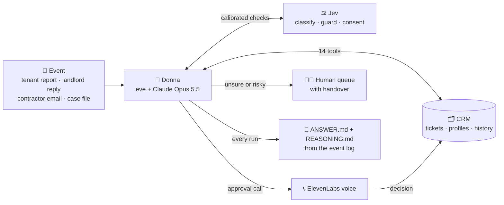
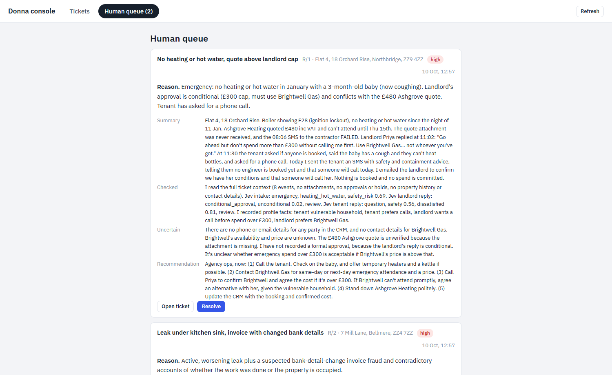
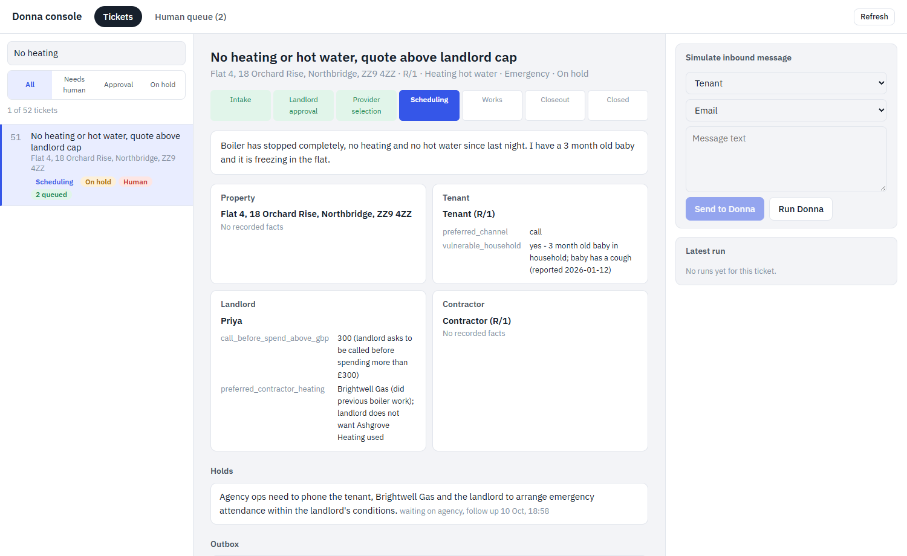
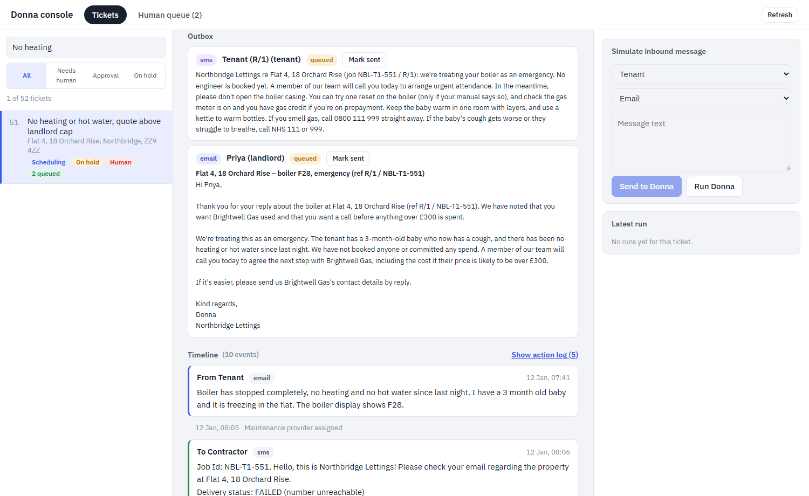
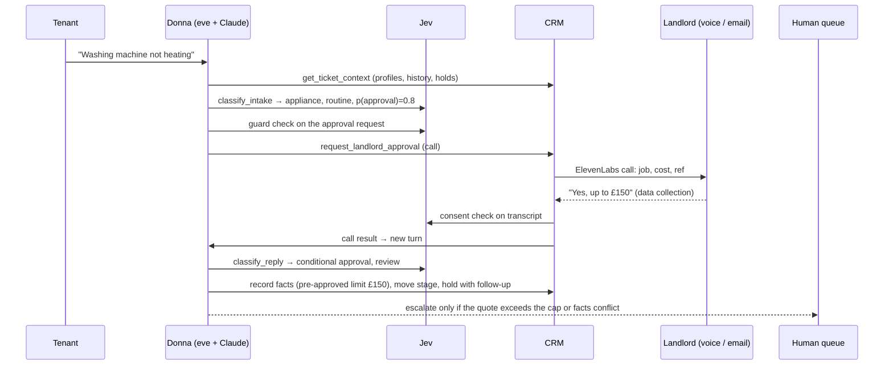

# Donna: an AI-native maintenance operations agent for lettings

Built for the Dwelly London AI Hackathon 2026, **Property Management** track.

Donna runs residential maintenance requests end to end. She reads everything known about the property and the people, decides the next step, acts through a small AI-native CRM, and hands over to a human only when a decision isn't hers to make. She is event-driven, not a chatbot: a tenant report, a landlord reply, a contractor email or a follow-up date triggers her, and her output is real changes in the CRM plus an auditable record of what she did and why.

| | |
|---|---|
| **Agent** | [eve](https://eve.dev) + Claude Opus 5.5 (direct Anthropic API), 14 tools |
| **Memory** | SQLite CRM with per-person and per-property profiles, every fact sourced |
| **Calibrated judgement** | Jev (TypeSafe AI) at intake, on every inbound reply, on every outbound action, and on call consent |
| **Voice** | ElevenLabs Agents: browser calls, and real phone calls over Twilio |
| **Results** | Practice eval 18/20 pass, 0 fail, 0 critical failures; Jev intake 94% category accuracy |

---

## 1. What we built

- **A CRM that remembers.** Every property, tenant, landlord and contractor has a profile of facts: preferred channel, pets, access considerations, pre-approved spend limit, "pays contractor directly", appliance history. Each fact records the event it came from. A contradicting fact is stored next to the old one and flagged as a conflict, never overwritten, so the next call or email starts with full, honest context.
- **An agent that acts.** Donna works through 14 tools: read the ticket and profiles, search the history, read attachments (PDF invoices and reports, photos), classify the request and each reply, record facts, move the pipeline stage, place and release holds with follow-up dates, request landlord approval by email or call, record the landlord's answer, message tenants, landlords and contractors, find existing cases, and escalate to a human queue with a structured handover.
- **Calibrated autonomy with Jev.** Jev returns calibrated probabilities in about 250 ms, which lets thresholds mean the same thing every time:
  1. *Intake:* category, severity, and the probability that a request needs landlord approval, is safely self-fixable, is a safety risk, or needs more information.
  2. *Every inbound reply:* intent (approve, decline, conditional, question, quote, invoice, completion...) and whether a human needs to respond. This is the exact "check if we need to respond, else return to auto mode" handoff that Dwelly's current system sends to a person every time.
  3. *Every outbound action:* a guard blocks messages that claim unverified completion, promise unconfirmed dates, contain credentials or bank details, commit the landlord's money, or record a conditional answer as an approval.
  4. *Call consent:* a transcript only counts as landlord approval if it is a clear, unconditional yes.
- **Voice approvals.** From the operations console, an ElevenLabs voice agent calls the landlord (in the browser, or as a real phone call over Twilio), explains the job and the cost, and records approve / reject / "only up to £X". The decision lands in the CRM and Donna continues the workflow.
- **An operations console.** Tickets with the pipeline stage, profiles (conflicts in red), the timeline, holds, approvals and outbox, a human queue of escalations, an inbound-message simulator, and the call controls.
- **A Reality Test runner.** Unseen cases are imported into the CRM and processed unattended. `ANSWER.md` and `REASONING.md` are rendered only from the recorded eve event stream and the CRM before/after diff, so they cannot be hand-edited or invented.

## 2. The operational problem

We analysed the 50 public Property Management cases (`docs/` and the workflow notes). They look like exports from Dwelly's own maintenance system, and they show where operations stall:

- **Every inbound reply stops automation.** The system logs "Please check if we need to provide a response… If not, please return this request to auto mode" 53 times across 50 cases, plus "Message received… please review and proceed manually".
- **Cases sit on hold.** 236 holds (4.7 per case), most "Waiting for Provider" or "Waiting for Landlord".
- **Contractor emails fail extraction** ("expected data could not be extracted, please review manually"), and invoices name the same provider three different ways.
- **Long cycle times.** Cases run from under a day to 136 days.
- **A third need no contractor.** 17 of 50 closed "without payment": the tenant or landlord fixed it.

Donna takes those handoff decisions herself (reply, advance the stage, hold with a follow-up date, request approval) and escalates only what genuinely needs a person, with a handover a human can act on in a minute.

## 3. Architecture



1. **An event arrives**: a tenant report, a landlord or contractor reply, or a Reality Test case file (imported into the CRM).
2. **Donna loads context** from the CRM: the ticket, the property's history and every person's profile.
3. **Jev scores it**: what kind of request, how urgent, and whether a reply can be handled automatically.
4. **Donna acts through tools**: replies, moves the stage, places a hold with a follow-up date, or asks the landlord for approval, by email or a voice call. Jev checks each outbound action before it goes.
5. **When it isn't her call**, she escalates to the human queue with a handover a person can act on in a minute.
6. **Every run is recorded**, and the answer files are generated from that log.

### See it

**Donna's handover in the human queue.** An emergency with a conditional landlord approval: what she checked (including Jev's probabilities), what is uncertain, and what a person should do next.



**The profiles Donna built while working.** The tenant is a vulnerable household that prefers calls; the landlord wants a call before any spend over £300 and prefers Brightwell Gas. Every fact cites the event it came from, so the next call starts with this context.



**What she actually sent.** Safety advice and an honest status ("no engineer is booked yet"), never a false promise. The failed contractor SMS is visible in the timeline.



**One request, end to end**



### Repository layout

| Folder | What it is |
|---|---|
| `agent/` | The eve agent: `agent.ts` (Claude via the Anthropic API, no gateway), `instructions.md` (judgement rules), `tools/` (14 tools), `channels/eve.ts` (HTTP Basic auth for self-hosting) |
| `crm/` | SQLite schema (`node:sqlite`), typed repository, case importer, attachment reader, source tracking |
| `intake/` | Jev layers: intake classifier, reply classifier + autonomy thresholds, outbound guard, consent check, and their evals |
| `runner/` | Reality Test runner: case normalisation, CRM import, eve HTTP client, ANSWER/REASONING renderer |
| `practice/` | Practice evaluation at Dwelly's real handoff points with a Claude judge |
| `console/` | Operations console (Vite + React, small Node API) with the outbox worker for email and calls |
| `scripts/` | Reproducible ElevenLabs voice agent and phone number setup |
| `docs/` | Eval reports, Jev layers, eve notes, ElevenLabs configuration |
| `data/` | Intake labels, practice runs with full traces, Reality Test trial cases (synthetic) |

### Donna's tools

| Tool | Purpose |
|---|---|
| `get_ticket_context` | Ticket, stage, property history, every profile and its facts, recent events, holds, approvals, attachments |
| `search_case`, `find_tickets` | Search a ticket's full history; find an existing case when someone calls again |
| `read_attachment` | Transcribe PDFs and photos with Claude (names, references, amounts, dates; flags what's unclear) |
| `classify_intake`, `classify_reply` | Jev classification of new requests and of each inbound reply |
| `add_profile_fact` | Record a sourced fact; conflicts are flagged, never overwritten; credentials refused |
| `move_stage`, `place_hold`, `release_hold` | Pipeline control with validated transitions and follow-up dates |
| `request_landlord_approval`, `record_approval_response` | Approval round-trip by email or call; Jev blocks conditional answers being recorded as yes |
| `send_message` | Email/SMS to tenant, landlord or contractor through the outbox, checked by the Jev guard |
| `escalate_to_human` | Human queue entry: what happened, what was checked, what's uncertain, recommended next step |

## 4. How to run

**Prerequisites:** Node 24, npm. Copy `.env.example` to `.env` and fill in the keys you have (see section 5).

```bash
npm ci
npm run crm:import            # load the 50 public Property Management cases into the CRM
npx eve dev --no-ui           # agent API on http://127.0.0.1:2000
npm test                      # 24 unit tests (CRM, Jev parsing/guards, renderer)
```

**Reality Test (unattended):**

```bash
npm run reality -- "<folder with the test cases>"
# writes ANSWERS/<n>/ANSWER.md, REASONING.md, events.ndjson, run.json and ANSWERS/INDEX.md
```

The runner accepts the public layout (`index.md`, `history.md`, `attachments/`) and also folders of arbitrary text files or single `.md`/`.txt`/`.json` files, which it normalises before import.

**Operations console:**

```bash
cd console && npm ci && npm run dev    # http://localhost:5181 (API on :5180)
```

See `console/README.md` for the demo flow and the voice/phone setup.

**Evaluations:**

```bash
npm run intake:eval                    # Jev intake accuracy on all 50 cases
node practice/decision-points.ts       # find Dwelly's handoff points
node practice/run.ts --limit 20        # run Donna at those points (start eve with CRM_DB=data/practice/practice.db)
node practice/judge.ts && node practice/report.ts
node intake/guard-eval.ts              # Jev guard / reply classifier eval
```

**Self-hosting on a VPS:**

```bash
npx eve build
PORT=3000 npx eve start --host 0.0.0.0
```

Put a TLS reverse proxy (Caddy or nginx) in front and forward **both** `/eve/` and `/.well-known/workflow/`. Persist `.eve/.workflow-data` and `data/crm.db`, set `DONNA_API_PASSWORD`, and run under pm2 or systemd.

## 5. Models, APIs and services

| Service | Used for | Env |
|---|---|---|
| Anthropic Claude Opus 5.5 (direct API) | Donna's reasoning and tool use | `ANTHROPIC_API_KEY`, `DONNA_MODEL` |
| Anthropic Claude Sonnet 5.5 | Attachment transcription; practice-eval judge | same key |
| Jev by TypeSafe AI (`jev-latest`) | Intake, reply, guard and consent classification | `TYPESAFE_API_KEY` |
| ElevenLabs Agents | Landlord approval calls (browser and phone) | `ELEVENLABS_API_KEY`, `ELEVENLABS_AGENT_ID`, `ELEVENLABS_PHONE_NUMBER_ID` |
| Twilio (trial) | Phone line for real calls, via ElevenLabs | `TWILIO_ACCOUNT_SID`, `TWILIO_AUTH_TOKEN`, `TWILIO_PHONE_NUMBER`, `DEMO_PHONE_TO` |
| Resend | Outbound email delivery | `RESEND_API_KEY`, `DEMO_EMAIL_TO` |
| eve (Vercel, open source) | Agent framework: tools, durable sessions, event stream, traces | `DONNA_API_USER`, `DONNA_API_PASSWORD`, `EVE_URL` |
| Node `node:sqlite` | CRM storage | `CRM_DB` |

## Measured results

| Evaluation | Result | Evidence |
|---|---|---|
| Practice eval: Donna at Dwelly's real handoff points in the public cases, judged by Claude against what the operator actually did next | **18/20 pass, 2 partial, 0 fail, 0 critical failures**; mean correct outcome 4.2/5, judgement & safety 4.1/5 | `docs/practice-eval.md`; every run's `ANSWER.md`, `REASONING.md` and raw events in `data/practice/answers/` |
| Jev intake classifier, all 50 public cases | **94% category accuracy** (47/50), ~250 ms per request | `docs/intake-eval.md` |
| Jev outbound guard, hand-labelled set | **12/12** | `docs/jev-guards-eval.md` |
| Jev reply intent / autonomy, hand-labelled set | **10/10** intent, 9/10 autonomy (one conservative miss) | `docs/jev-guards-eval.md` |

The evaluations found and drove these fixes: a Jev score-parsing bug that inflated "emergency" severity; a SQLite lock under concurrent runs; attachments from the future leaking into the practice harness; and over-escalation of routine cases, now addressed by a "be proportionate" rule in `agent/instructions.md`.

## Safety and integrity

- **No invented facts.** Unknowns go under "could not be verified" in every answer; the guard blocks unverified claims of completion, booking or payment.
- **No money without approval.** Landlord approval is required unless a recorded pre-approved limit covers the job, or for emergency safety work, which is always escalated.
- **No credentials stored.** Passwords, alarm and key-safe codes and bank details are refused by the fact tool and blocked by the guard; changed bank details on an invoice are escalated.
- **Prompt-injection resistant input.** Case content is passed as data inside `<case_file>` and the instructions treat embedded instructions as information.
- **Demo-mode delivery.** Every real email and phone call goes only to the team's own inbox and verified number; the intended recipient is shown in the message.
- **Honest results.** Reality Test answers are rendered from the recorded event stream; failed runs are reported as failed.

## 6. Key assumptions

- Reality Test cases describe UK residential lettings maintenance and arrive as case folders or text files similar to the public cases.
- Outbound email and SMS go to the CRM outbox for delivery; in demo mode they are redirected to the team.
- A landlord's pre-approved limit, when recorded in their profile, lets Donna proceed without asking.
- Emergency safety work may proceed before approval, with the landlord notified and a human escalation.
- The recorded human action in a public case is one acceptable answer, not the only one.

## 7. Known limitations

- **Practice sample size.** 20 of 76 decision points were judged, to conserve API credits; the judge is itself an LLM.
- **Remaining partials are over-caution.** Donna sometimes holds or escalates where the human operator proceeded, for example a landlord deferring a door repair after a reported glass-safety concern. We kept the safety bias.
- **Synthetic contacts.** Case contacts have no real addresses or numbers, hence the demo-mode redirect.
- **Inbound email** is simulated in the console; real inbound needs a verified domain and a webhook.
- **Sparse starting profiles.** The deterministic importer only extracts facts it can parse reliably; profiles grow as Donna records facts during work.
- **Attachments** are transcribed on demand; very large PDFs or poor photos may lose detail, which Donna reports as unverified.
- **Single node.** SQLite and eve's local workflow store suit one VPS; multi-agency scale would move to Postgres and a hosted workflow world.

## 8. What we would build next

- Real channels end to end: inbound email and SMS webhooks, WhatsApp, and tenant-initiated voice calls into the same CRM context.
- Contractor performance in profiles (response time, invoice accuracy, no-shows) feeding provider selection.
- Scheduled follow-ups with eve schedules, so every hold is chased on its date.
- A larger human-labelled evaluation set from Dwelly's real handoffs, tracked per release, with autonomy thresholds tuned per agency.
- Landlord preferences and pre-approval limits captured at onboarding, so most routine jobs never need an approval round-trip.

## License

Apache License 2.0. See `LICENSE`.
